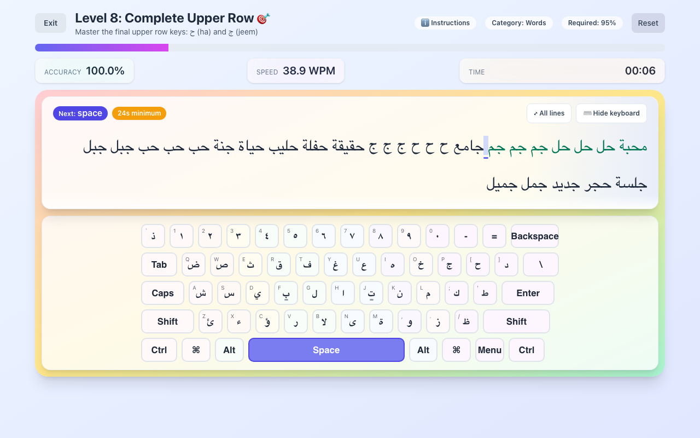
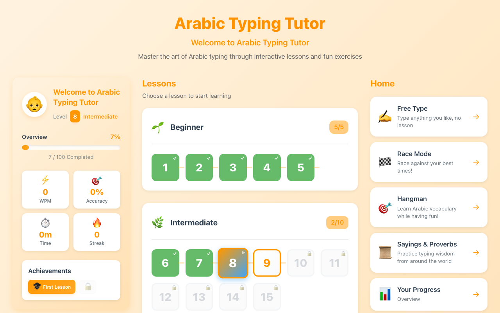

# Arabic Typing Tutor

Learn to touch-type Arabic on the keyboard you already own, no Arabic keycaps needed.

**[⬇ Download the latest release](https://github.com/ST3-Studios/att/releases/latest)** (macOS and Windows, free)

## Features
- 30 progressive lessons, from the home row to full paragraphs (70 more on the way)
- On-screen Arabic keyboard that lights up the next key, with bilingual keycaps
- Proper right-to-left typing with correctly joined Arabic letters
- Two-line focus view, or expand to see the whole passage
- Free Type mode, plus Race, Hangman and Sayings & Proverbs games
- Progress overview, achievement badges, and kid / teen / adult themes
- Interface in Arabic, English and German (French and Spanish coming soon)

## Install
Download the file for your system from the [releases page](https://github.com/ST3-Studios/att/releases/latest).

The app isn't code-signed yet:
- **macOS:** right-click the app → **Open** → **Open** the first time.
- **Windows:** on the SmartScreen prompt, click **More info → Run anyway**.

Then add an Arabic keyboard to your system:
- **macOS:** add the **Arabic – PC** input source.
- **Windows:** add **Arabic (101)**.

## itch.io edition
The itch.io edition adds **Practice Packs**: drills for harakat (short vowels), hamza forms, lam-alef, and Arabic punctuation and digits.

## Feedback
Found a bug or have an idea? [Open an issue](https://github.com/ST3-Studios/att/issues).

© ST3 Studios
